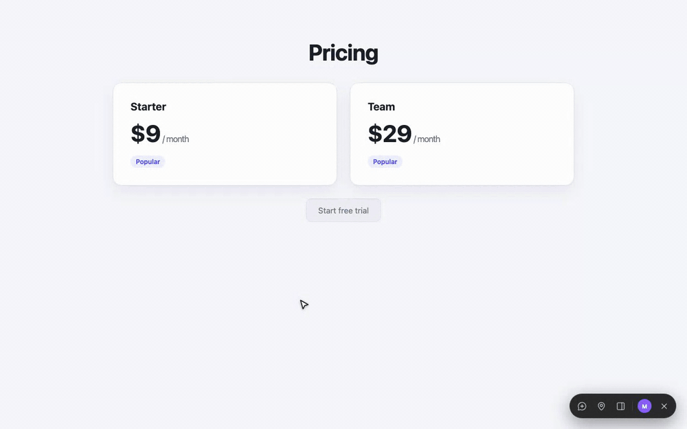
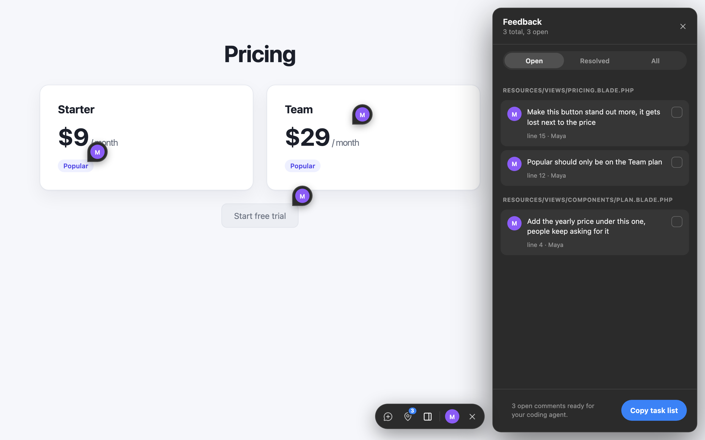

<p align="center">
  <a href="https://ontrackd.com">
    <picture>
      <source media="(prefers-color-scheme: dark)" srcset="https://ontrackd.com/brand/ontrackd-wordmark-dark.svg">
      
    </picture>
  </a>
</p>

<p align="center">
  Feedback on your Laravel pages that lands on the right Blade line.
</p>

<p align="center">
  <a href="https://app.ontrackd.com"><strong>Create a free account</strong></a>
  &nbsp;·&nbsp;
  <a href="https://ontrackd.com/pricing">Pricing</a>
  &nbsp;·&nbsp;
  <a href="https://ontrackd.com/docs/">Guide</a>
  &nbsp;·&nbsp;
  <a href="https://ontrackd.com">ontrackd.com</a>
</p>

<p align="center">
  
</p>

You know the drill. Someone sends a screenshot with a red circle and "this looks off", and you spend
ten minutes working out which view, which partial and which line they mean.

With ontrackd, they click the thing on the page and type. The comment arrives with
`resources/views/pricing.blade.php:12` attached, plus a screenshot, the page and the screen size. You open the file, fix it, mark it done. Or you hand the whole list to your coding agent
and let it do the first pass.

This package is the Laravel side of it. Install it and every page your app renders can take
comments, on your own machine while you build and on the previews you share with clients.

## What you get

- **Comments pinned to code.** Each element knows the Blade file and line that rendered it. With
  Inertia, React, Vue and Svelte components are pinned to their own file too.
- **Reviewers don't need an account.** Send a client a review link and they comment straight on the
  preview. You see everything in one dashboard.
- **Your agent can do the fixes.** Claude Code, Cursor, Codex and friends read the open comments over
  MCP, with the exact lines to change, and mark each one resolved when it's done.
  [Connect your agent](https://ontrackd.com/docs/agent/).
- **Nothing in production.** Keep the project secret out of production and the package adds nothing
  to your pages there.

<p align="center">
  
</p>

## Install

You need Laravel 11, 12 or 13, PHP 8.2 or later, and Vite.

```bash
composer require ontrackd/laravel
npm i -D @ontrackd/feedback
```

Then add the Vite plugin, before `laravel()`:

```js
// vite.config.js
import { feedback } from '@ontrackd/feedback/vite';

export default defineConfig({
    plugins: [
        feedback({ shared: Boolean(process.env.FEEDBACK_SECRET) }),
        laravel({ /* … */ }),
    ],
});
```

Or let `npx @ontrackd/feedback init` do all three for you.

Run `npm run dev` and `php artisan serve`, open your app, and press <kbd>Alt</kbd> <kbd>Shift</kbd>
<kbd>F</kbd> (<kbd>⌥</kbd> <kbd>⇧</kbd> <kbd>F</kbd> on a Mac) if the bar isn't showing. Click
anything and leave a comment. That's it: the service provider registers itself, and the widget is
added to every HTML page just before `</head>`. If you'd rather place it yourself, set
`FEEDBACK_INJECT=false` and put `@feedback` in your layout's `<head>`.

Without an account, comments stay on your machine. To share previews and work with your team,
[create a free account](https://app.ontrackd.com), make a project, and copy its secret from the
**Setup** tab into `.env`:

```ini
FEEDBACK_SECRET=sk_prj_…
```

Your dev server then asks you to sign in once, and your comments go to the project. Nothing to
register: `127.0.0.1:8000`, `localhost` and Herd or Valet's `*.test` domains work on any port.

## Previews

Set `FEEDBACK_SECRET` wherever your previews are deployed, and add one line to the deploy, after the
assets are built:

```bash
npm run build
php artisan feedback:manifest
```

That reads your views, uploads a small map from elements back to Blade lines, and recompiles the
views with it. Comments on the preview then come with their file and line, like they do locally.
Skip it and comments still work; they just describe the element instead of pointing at the line.

The map is written to `.feedback/` before it goes up, so add that folder to your `.gitignore`.

[Sharing a preview](https://ontrackd.com/docs/share-a-preview/) covers allowed sites and review links.

## Good to know

- **Attachments and `post_max_size`.** Reviewers can attach files up to 10 MB. PHP refuses anything
  over `post_max_size` (8 MB by default) before Laravel even sees it, so set it to `11M` or more in the
  `php.ini` your dev server uses. `php --ini` tells you which one that is.
- **Component tags aren't stamped.** On `<x-card>` or `<livewire:counter>` the attribute would turn
  into a prop, so the package leaves them alone. Their own views are stamped, and so is whatever you
  pass into their slots, on the line where you wrote it.
- **Inertia SSR works.** With `vite build && vite build --ssr`, the manifest uses the client build,
  which is the one with the styles.
- **State lives in `storage/framework/cache`**, which Laravel already ignores.

## How it behaves, by environment

| Where | What gets stamped | Where comments go |
| --- | --- | --- |
| `APP_ENV=local` and `npm run dev` | `data-fb-src` with the Blade file, line and column | Your machine |
| The same, with `FEEDBACK_SECRET` in `.env` | The same | Your project, with your git branch |
| A preview, with the secret and a manifest | An opaque `data-fb-id`, explained by the manifest | Your project, pinned to that build |
| A preview, with the secret and no manifest | Nothing | Your project, elements described |
| Production, no secret | Nothing | Nowhere. Nothing is added |

## Help

Start with the [guide](https://ontrackd.com/docs/) and
[troubleshooting](https://ontrackd.com/docs/reference/troubleshooting/). Found a bug in the package?
[Open an issue](https://github.com/Ontrackd/laravel/issues).

## License

This package is free to use with an [ontrackd](https://ontrackd.com) account, on any plan, the free
one included. You can read it, change it for your app and ship it inside your app. You can't use it
with another service or to build one that competes with ontrackd. The full terms are in
[LICENSE](LICENSE).
